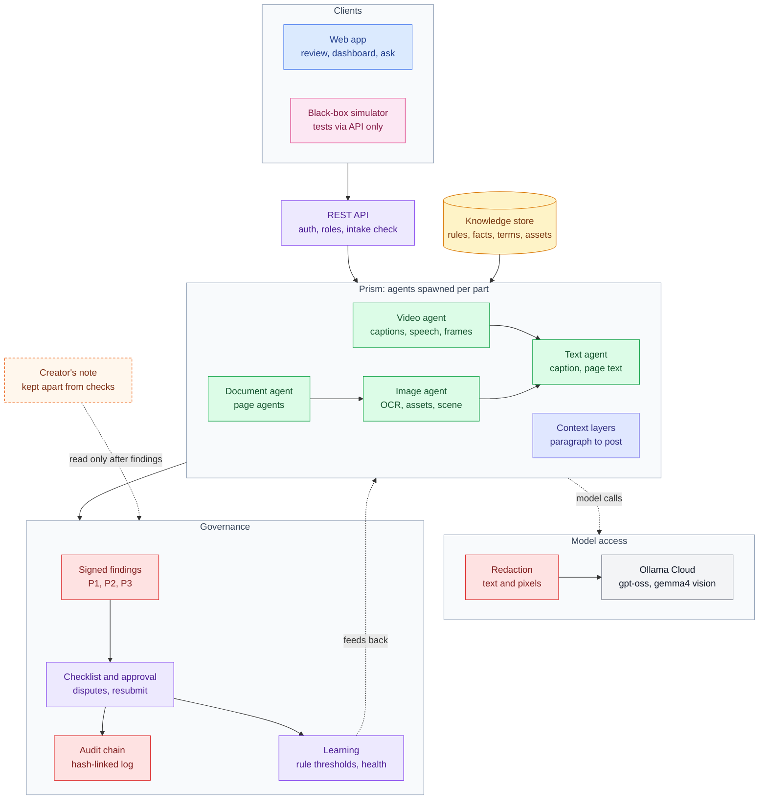
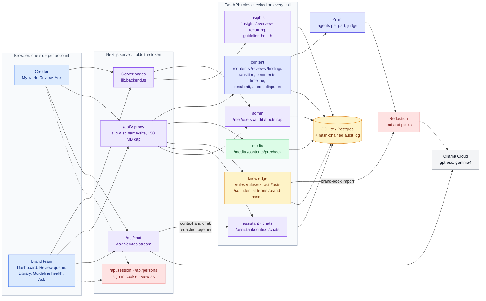

# Verytas

**Brand governance before you hit publish.** Verytas reviews content against a company's approved rules, time-valid facts and confidential terms. It explains every issue with a citation, proposes the smallest fix that keeps the writer's intent, and routes the piece through a human approval workflow. It also learns which guidelines are unclear from how reviewers override them.

Built for the Inkloom AI brand-governance challenge. Brief: [`docs/problem-statement.md`](docs/problem-statement.md) · design: [`docs/architecture.md`](docs/architecture.md)

## What it does

- **Reads everything a post contains.** The caption, images (with local OCR), PDFs and Word files page by page (text layers, scanned pages and screenshots pasted inside them), and video (burned-in captions, on-screen text, subtitle tracks and speech).
- **Checks it all the same way** for banned and preferred wording, brand casing, leaked codenames, outdated or inflated statistics, unsupported claims, tone, AI-disclosure labels and accessibility.
- **Guards the brand's own artwork.** Official logos and mascots are ground truth: altered details, garbled wordmarks, look-alikes and bodies attached to an approved face are flagged, with the pixel region.
- **Reads between the lines.** Context layers widen from a paragraph to the whole post to caption plus image, catching indirect taunts, sarcasm and meanings that depend on the language (Hinglish included).
- **Explains, fixes and keeps humans in charge.** Every finding cites its rule or fact. Creators work through a P1/P2/P3 checklist, apply fixes, dispute misreadings and resubmit; blockers and unread content need a noted override.
- **Learns from the people using it.** Disputes and reviewer decisions tune how sure each model-judged rule must be, and guideline health shows which rules are unclear.

## The console

The console has two sides, and each account sees only its own: **creators** write and fix their pieces; the **brand team** (reviewers, approvers, auditors and brand admins) decides on them and keeps the library. The API enforces the same split on every call.

| Side | Screen | What you do there |
| --- | --- | --- |
| Creator | **My work** | See what needs you (drafts and pieces sent back), what is with the brand team, and the team's latest comments and decisions. |
| Creator | **Review** | Start a review, or reopen one of yours. The text shows every issue in place beside a P1/P2/P3 checklist. Edit, apply fixes, dispute and re-check, then send it for approval. |
| Brand team | **Dashboard** | Need-to-knows (waiting, must-fix issues in the queue, failed checks, unclear rules), the pipeline drawn as a flow with its send-back loop, the decision queue, and brand-health charts. |
| Brand team | **Review queue** | Work the queue by stage: waiting, with creator, approved, all. On a piece, confirm, dismiss (with a reason) or escalate each finding, then approve or send it back with a note. |
| Brand team | **Brand library** | Rules (versioned edits, word-list matchers, drafts to activate), facts with validity dates, confidential terms, official artwork, and brand-book import: paste or upload a PDF or Word file, review the proposed rules, keep what reads right as drafts. |
| Brand team | **Guideline health** | Find the rules reviewers override or disagree on most, with advice on what to clarify. |
| Both | **Ask Verytas** | Ask about pieces and review data. Answers come as charts and tables. The context and your questions are redacted together before they reach the model, and confidential-tier content is left out. |

Every open piece shows the same **journey map** to both sides (written, checked, sent for approval, approved, published, with each round of changes), an **activity** feed with threaded comments, and **track changes** between any two versions. Settings has an **AI and data** page that lists every model and service and where it runs.

With sign-in off, Settings offers **View as** to switch between a brand-team and a creator account (`VERYTAS_API_TOKEN` and `VERYTAS_CREATOR_TOKEN`); `python -m verytas.cli issue-token <email>` issues one. Sidebars and history rails collapse to icons, and each browser remembers the choice.

## Architecture



**Legend:** blue = clients · purple = API, workflow and learning · green = agents per content type · indigo = context layers · red = security · amber = data · grey = external models · dashed orange = the creator's note, a separate realm · pink = test harness

### How the endpoints fit together




The browser talks only to the Next.js server, which holds the token and forwards an allowlist of routes. The full route table, with who may call each one, is in [`docs/architecture.md`](docs/architecture.md#14-apis-as-built).

### How a review flows

1. A creator uploads a caption plus any images, documents and video. Before anything is accepted, the intake check compares it with what the channel normally carries (caption length, page count, image size, video length, hidden characters). Anything irregular needs a reason, and still counts against the score.
2. **Prism** loads the rules, facts and official assets the content's tier may see, then spawns an agent per part. Agents spawn their own: a PDF gets a page agent per page, each pasted screenshot an image agent, each image its OCR, asset and scene agents, and every piece of text found a text agent running the same checks as typed text. Depth and agent counts are capped; anything cut off is reported as not checked.
3. Text is read locally first. Confidential terms are **blacked out in the pixels** before any image or video frame reaches the vision model, and redacted from all text sent to a model. Confidential-tier content never leaves the machine as pixels.
4. **Context layers** then read the whole submission, from paragraphs to the full post to caption plus images. Each candidate must quote real text and pass an independent judge question.
5. Only now is the **creator's note** weighed, and only against model-judged findings. It can cap a far-fetched reading at advisory, never clear a mechanical one; a note that tries to steer the review is escalated.
6. Findings are **signed**, ordered P1 to P3, and shown as a checklist. Creators tick what they fixed, apply suggestions, dispute misreadings and resubmit. Disputes are re-judged layer by layer without the claim in view, and the system can still say no. Every step lands in the **hash-chained audit log**, and outcomes tune each rule's threshold.

## Tested from the outside

[`blackbox/`](blackbox/README.md) is a reality simulator that knows Verytas only through its API. It invents brand worlds, writes roasts, flame wars, Hinglish captions and crisis apologies inside them, and plants violations with exact ground truth, including evasive spellings. A bandit then steers each generation toward what Verytas misses. Its first runs found that public posts skipped the built-in checks, that look-alike letters slipped past banned-term and leak checks, and that parallel submissions hit database deadlocks and 500s.

On a 216-case campaign, core recall rose from 78% to 96%, false positives on controls fell from 7% to 0%, and server errors went from 17 to 0, even at 32 parallel submissions.

## Repository layout

| Path | What |
| --- | --- |
| `backend/` | FastAPI service: checks, Prism, workflow, insights, security (Python 3.12+) |
| `web/` | Next.js 16 on OpenUI: both sides of the console (homes, review, library, guideline health, Ask Verytas) |
| `blackbox/` | Black-box reality simulator: invents brands, writes posts, images, PDFs and video, grades Verytas |
| `docs/` | Problem statement, architecture, submission checklist |

## Run locally

```bash
# Backend on :8000 (tests run fully offline, no keys needed)
cd backend
python3 -m venv .venv && .venv/bin/pip install -e ".[dev]"
cp .env.example .env              # add OLLAMA_API_KEY for live models
.venv/bin/uvicorn verytas.main:app --reload
.venv/bin/pytest -q

# Frontend on :3000
cd web
pnpm install
cp .env.example .env.local        # VERYTAS_API_URL + VERYTAS_API_TOKEN for live data, OLLAMA_API_KEY for Ask
pnpm dev
```

On first run, `POST /bootstrap` creates the workspace and returns an admin token (interactive docs at `/docs`). Without backend settings, the frontend shows clearly labelled demo data.

## Models and external services

| Service | Used for | When |
| --- | --- | --- |
| Ollama Cloud (`gpt-oss:120b`, `gpt-oss:20b`) | claim extraction, explanations, fixes, the semantic judge, context layers, disputes, Ask Verytas, simulator content | when `OLLAMA_API_KEY` is set |
| Ollama Cloud (`gemma4:31b`) | image and video-frame understanding, asset comparison, OCR fallback | when `OLLAMA_API_KEY` is set; never for confidential-tier content |
| RapidOCR, faster-whisper, OpenCV, pdfium (local) | OCR, speech-to-text, asset matching, PDF rendering | always local; nothing leaves the machine |
| TypeSafe Jev (`jev-1.13.0`) | semantic judge, if preferred | optional, when `TYPESAFE_API_KEY` is set |
| Anthropic Claude | alternative LLM backend | only with `VERYTAS_LLM_BACKEND=claude` |
| Sentry | error monitoring, without request bodies or PII | only when `SENTRY_DSN` is set |

With no keys, semantic checks fall back to an offline heuristic, and the scorecard marks them "degraded" rather than passed.

## Working agreement

- `main` is production; merging into it deploys. `dev` is the integration branch; open PRs into `dev`.
- Commit small and often from your own account, since judges may read the history.
- Disclose templates, boilerplate, external services and significant AI assistance, per the challenge rules.
