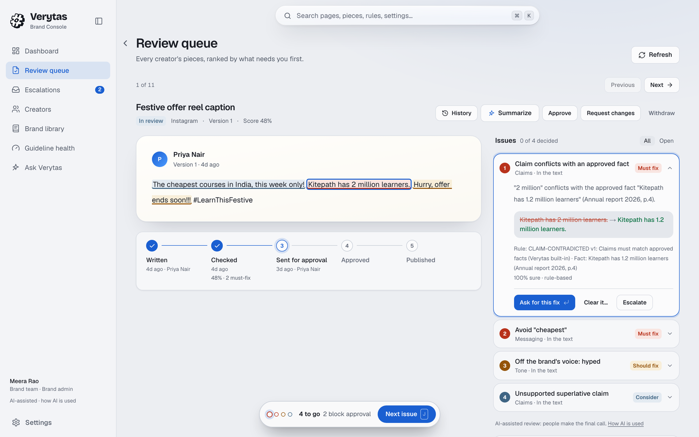
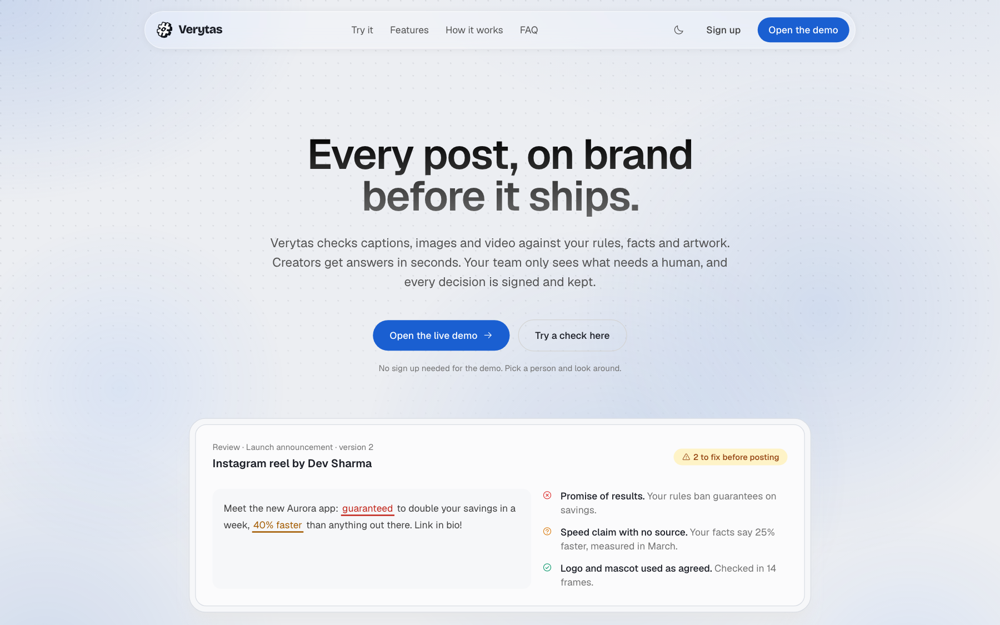
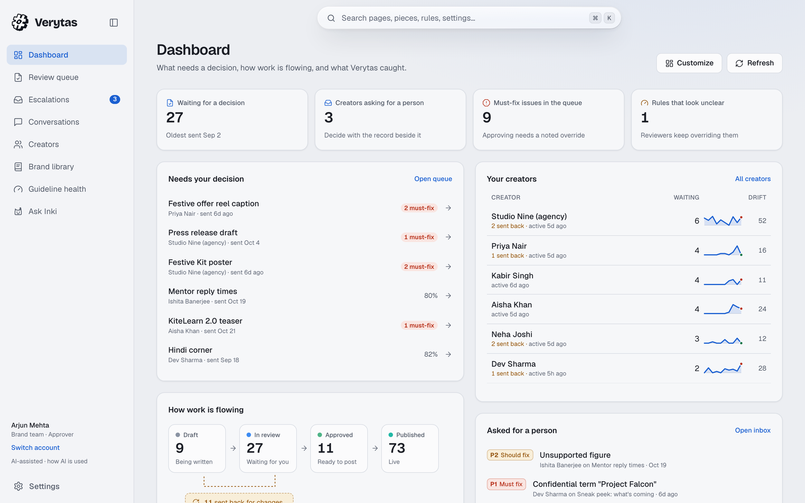
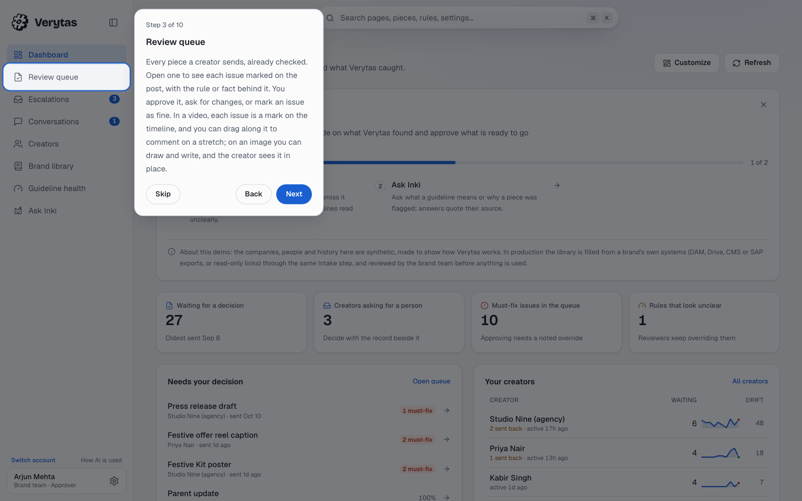
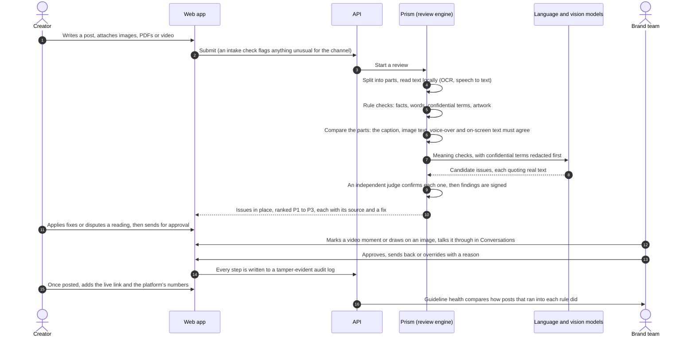
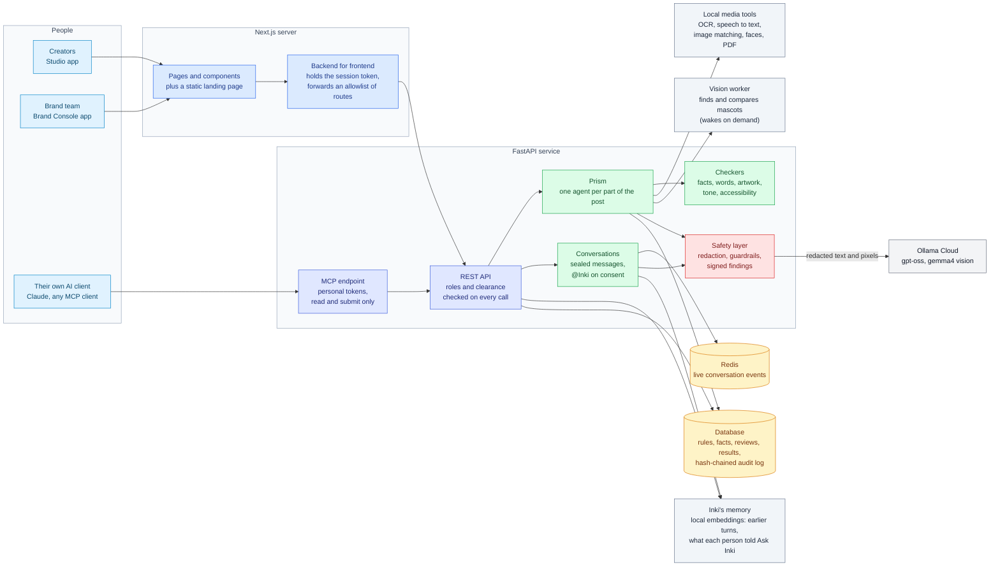
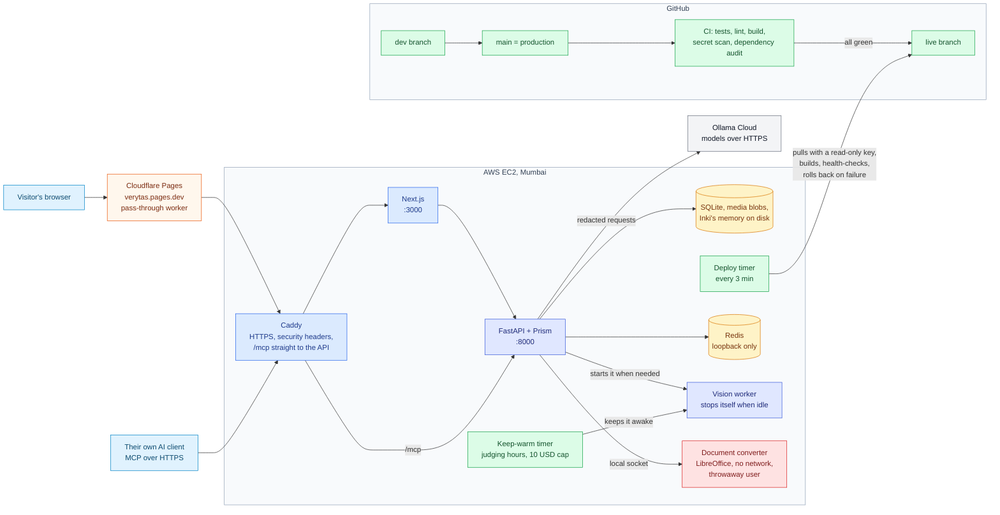
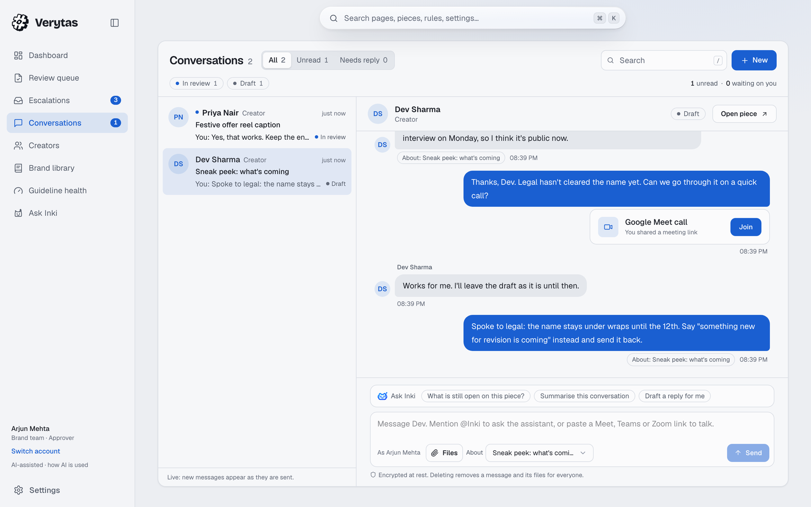

<div align="center">

<picture>
  <source media="(prefers-color-scheme: dark)" srcset="docs/assets/logo-dark.svg">
  
</picture>

# Verytas

**Brand review that shows its work.**

Verytas checks every post, caption, image, document and video against a brand's own rules and approved facts *before* it is published, explains each problem with a citation, suggests the smallest fix, and leaves the final call to a person.

[**Try the live demo**](https://verytas.pages.dev) · [Architecture](docs/architecture.md) · [Problem statement](docs/problem-statement.md)


</div>

<p align="center"></p>

## The problem

A brand works with dozens of creators and agencies who post every day, in many languages and formats. One wrong number, a leaked product codename or a snide line about a competitor can cost real money and trust. Checking all of it by hand doesn't scale, and generic AI checkers flag things without saying *why*, so people stop trusting them.

## What Verytas does

| Capability | What it means |
| --- | --- |
| **Reads every part of a post** | The caption, text inside images, every page of a PDF or Word file, every slide (speaker notes too), every sheet, HTML pages and emails, and video: on-screen text, subtitles and speech. |
| **Sees the pictures** | Finds the brand's artwork and says how it was misused (stretched, recoloured, redrawn), finds mascots even when an AI redrew them and names what changed, and flags faces shown without an agreement. |
| **Hears what is said** | English, Hindi and Hinglish speech is transcribed on the server; a codename is caught by its sound, and a spoken figure is checked like a written one. |
| **Checks against the brand's own sources** | Approved facts with validity dates, banned and preferred words, confidential terms, artwork, tone, accessibility and AI-disclosure rules. On a public post, a claim no fact backs also gets web results, English pages from known news and government sites that name the brand, as evidence for the reviewer, never a verdict. |
| **Explains and shows every flag** | Each issue quotes the passage and cites the rule or fact behind it, marked in place: in the caption, boxed on the image, page by page in documents. |
| **Fixes, not just flags** | The smallest fix (swap a phrase, rewrite a sentence, remove a dig), checked so the offer and call to action survive. One click applies it. |
| **Keeps people in charge** | Creators can dispute a finding; the brand team decides each one, and every override needs a written reason. A finding the brand team cleared stays cleared when the creator checks again. |
| **Keeps both sides in step** | Each dashboard opens on what the other side did since you were last here (approved, sent back, escalated, commented), a short notice says so on sign-in, and badges on *My reviews* and the *Review queue* update within a second, without a reload. |
| **Marks the exact spot** | Issues sit on the video timeline, comments cover a stretch of it, and images take drawn marks the creator sees in place. |
| **Talks it through** | *Conversations* beside each piece, encrypted at rest, with files and Join cards for meeting links. **@Inki** answers from the record once the asker agrees, and finds the earlier turns a question depends on. |
| **Answers from the record** | *Ask Inki* looks up creators, escalations, rules, facts, events and pieces as the person asking, so "which creators drift furthest from the brand" gets an answer from the data, and nobody learns more than their own screens show. |
| **Remembers how you work** | *Ask Inki* keeps what you say about your role and style, for you alone; Settings shows it and forgets it. On the demo's shared people it is per browser and lapses after a day. |
| **Learns** | Guideline health shows the rules reviewers keep overriding and how posts that broke a rule did once live; model-judged rules tune their confidence from decisions. |
| **Easy to pick up** | A guided tour, plain-word summaries, and help wherever a status or score appears, shaped by [user testing](docs/research/user-testing.md). |
| **Works from your AI client** | A personal token lets Claude or any MCP client read and submit as you, never approve ([how](docs/mcp.md)). |

## Try it in 60 seconds

<p align="center"></p>

1. Open **[verytas.pages.dev](https://verytas.pages.dev)** and pick a person at *Kitepath*, a made-up online learning brand with eight weeks of history. A short tour shows where things are; skip it, or replay it from Settings.
2. As **Dev Sharma** (creator), open *My reviews*, paste a caption like *"Kitepath has 2 million learners. Guaranteed results!"* and run it. The claim is checked against the approved fact (1.2 million), a fix appears, and the promise is flagged. Apply the fixes and send it for approval.
3. Use **Switch account** to become **Arjun Mehta** (brand team). Your piece is now in the review queue, ranked by what needs attention first. Approve it, or send it back with a note.

<p align="center"></p>

<p align="center"></p>

## How a review works



## Architecture



- **Two apps, one codebase.** Creators get *Studio*; the brand team gets the *Brand Console*. The API enforces the split on every call, so a creator can never open another creator's work.
- **The browser never holds an API key.** The Next.js server keeps the session token and forwards only an allowlisted set of routes.
- **Prism** splits a submission into its parts and spawns an agent for each one: a PDF gets an agent per page (a deck per slide, a workbook per sheet), every image inside it gets its own OCR and artwork agents, and every piece of text found goes through the same checks as typed text. Depth and agent counts are capped, and anything cut off is reported as *not checked* rather than silently passed.
- **Rules before models.** Facts, words, confidential terms and artwork are checked deterministically. Models only handle meaning (tone, implied claims, sarcasm), and a model-only finding can never block a post on its own.

## System design



| Decision | Why |
| --- | --- |
| **Pull-based deploys** | The server pulls a branch only green CI can move, builds beside the live release and rolls back if health checks fail. |
| **Media stays local** | OCR, speech, PDF rendering and artwork matching run on the server's CPU; only redacted text and pixels reach a model. |
| **Bounded and degradable** | Shared model slots, a cap on reviews at once and per-step deadlines; a provider that is down marks its checks *degraded* rather than failing or passing them. |
| **Vision on a worker that sleeps** | The mascot models run on a second instance that starts on demand and stops after 20 idle minutes. |
| **Untrusted files sealed off** | Word and PowerPoint are converted by LibreOffice in a throwaway service with no network and hard limits. |
| **One cheap server** | One small ARM instance behind a free edge, under a hard AWS budget cap. |

## Tech stack

| Layer | Tools |
| --- | --- |
| **Frontend** | Next.js 16 (App Router, React 19), Tailwind CSS 4, OpenUI for generated answers in *Ask Inki* |
| **Backend** | Python 3.12, FastAPI, SQLAlchemy 2 (async), SQLite (Postgres-ready), Pydantic |
| **AI models** | Ollama Cloud: `gpt-oss:120b` and `gpt-oss:20b` for language, `gemma4:31b` for vision. Swappable for TypeSafe Jev or Anthropic Claude |
| **Media, all local** | RapidOCR (ONNX Runtime), faster-whisper, OpenCV (with YuNet and SFace for faces), pdfium, PyAV, LibreOffice (sandboxed, for Word and PowerPoint previews) |
| **Inki's memory** | fastembed with `bge-small-en-v1.5` on ONNX Runtime (CPU, 65 MB), mem0 over an on-disk Qdrant store; no service and no telemetry |
| **Vision worker** | Grounding DINO (tiny), SAM 2.1 (tiny), DINOv2 (small) on PyTorch CPU, on an EC2 Graviton instance that wakes on demand |
| **Security** | Ed25519-signed findings, SHA-256 hash-chained audit log, text and pixel redaction, input guardrails, CSP |
| **Infra and delivery** | AWS EC2, Caddy, systemd, Cloudflare Pages, GitHub Actions (pinned to commit SHAs), gitleaks, pip-audit, pnpm audit |
| **Testing** | pytest (offline, no keys needed), a black-box simulator that tests only through the public API |

## Accessibility

**In what it reviews:** missing alt text, low contrast, CamelCase hashtags, "click here" links, long paragraphs,
uncaptioned speech and emoji runs, on for every brand. **In the app:** full keyboard use with visible focus,
labelled controls, announced updates, reduced motion on request, light and dark themes. Not audited by an
outside tester.

## Trust and security

- **Signed and logged.** Every finding is signed and every action goes into a hash-chained audit log, so an edit shows.
- **Confidential terms never reach a model:** they are redacted from text and blacked out in images first.
- **Hostile input is expected.** File types are read from the bytes and parsed within budgets, web pages render with no scripts, Office files convert in a sealed service, and instructions aimed at the AI are refused.
- **Role and clearance are checked on the server** on every request; sign-out revokes the session.
- **Your data stays yours.** Inki keeps facts only from your own Ask Inki chats, and forgetting removes them from disk. The first visit asks about cookies; nothing tracks you.
- **Audited.** A security review ran on the code and the live site; each finding is fixed with a regression test or listed as open in the [security report](docs/security/README.md). Dependencies install from hashed lock files.

## Round 3: what changed

The three improvements committed to after Round 2, and where each stands.

| Improvement | Built | Not built, and why |
|---|---|---|
| **Creators and managers talk it through** | *Conversations* beside each piece, with files, unread counts and Meet, Teams or Zoom links as Join cards. The thread, kept with its times beside the piece, is the meeting's record. | Voice through masked phone numbers: telephony is separate, paid infrastructure, and adds little for a prototype over the free meeting apps people already use. |
| **Sharper vision and speech** | Recoloured app icons found by outline (33% to 100%); mascot cut-outs repaired and stretching named (false alarms 64 to 50 of 180). The vision worker wakes on demand. Before and after: [artwork](backend/evals/results/assets.md), [mascots](backend/evals/results/mascots.md). | A GPU, and with it a stronger Hindi speech model: AWS refused the quota twice, so the models run on CPU. Codenames are matched by sound instead. |
| **The Brand Console runs it** | An approved-people tab with agreement dates, findings as marks on the video timeline, and markup on images and video moments that the creator sees in place. | |

<p align="center"></p>

**Also added:** performance feedback per rule in Guideline health, a personal-token MCP endpoint, a landing page,
memory for Inki ([measured here](backend/evals/results/memory.md)), lookups for Ask Inki, news and live badges
for both sides, web evidence for unbacked claims, and speaker notes and table rows read from slides and Word
files ([compared with LlamaIndex](backend/evals/results/ingestion.md)). **Reliability:** a test sends every API
route bad input as every role and fails on any server error, the live site is crawled as every demo person, and
every batch of changes is reviewed for bugs before it is committed.

## Quality

Each engine is measured on its own benchmark through the production code. The sets are generated or
hand-labelled rather than live traffic, so real-world figures will run somewhat lower. Each link has the
method and the full results.

| Engine | Tested on | Result |
| --- | --- | --- |
| [Artwork](backend/evals/results/assets.md) | 1,200 scenes | **96%** of misuse caught, **4.7%** false alarms; recoloured app icons **24/24** (33% before), found by outline when the colours are swapped |
| [Mascots](backend/evals/mascots) | 425 scenes | every character found; most defects named (extra eyes 25/28, recolours 30/30), a stretched body 18/30 (was 0); false alarms on acceptable characters 50/180 (was 64) ([details](backend/evals/results/mascots.md)) |
| [Text in images](backend/evals/results/ocr.md) | 240 images | **88%** of prices, codes and names read exactly |
| [Speech](backend/evals/results/speech.md) | 104 clips | about **10%** word error in English; Hindi much weaker, so codenames are also matched by sound |
| [Video](backend/evals/results/video.md) | 36 videos | on-screen claims **11/11**, spoken claims **8/10**, artwork misuse 32/45, each at the right moment |
| [Parts that disagree](backend/evals/results/crossmodal.md) | 28 posts | **14/14** caught, **0** false alarms |
| [Judgement rules](backend/evals/results/second_look.md) | 32 sentences | **30/32** right |
| [Suggested fixes](backend/evals/results/summary.md) | 73 findings | **82%** useful (45% before), **0** invented numbers |
| [Reading documents](backend/evals/results/ingestion.md) | 6 files + 3 hostile ones, against LlamaIndex's readers | every table row kept together in PDF, Word and slides (LlamaIndex: none in PDF and Word), every sheet value with its cell address (LlamaIndex: none), a 300 MB spreadsheet bomb capped in 0.1 s (LlamaIndex: 36 s and 2.9 GB) |
| [Inki's memory](backend/evals/results/memory.md) | 28 long conversations, 5 seeds each | an early decision reaches Inki in about **3 in 4** conversations it was never tuned on (**0%** before, with only the last 12 turns); **5/5** answered right on the live demo |
| [Black-box simulator](blackbox/README.md) | 216 cases | **96%** recall, **0%** false alarms on clean posts |

- **785 backend tests** run offline on every push, with type checks, lint and a production build for the web app.
- **Tried by people:** three first-time users used the live demo; every point they raised has a shipped change ([report](docs/research/user-testing.md)).
- **Tested from the outside:** [`blackbox/`](blackbox/README.md) knows Verytas only through its API and steers each round toward what it misses.

## Known limits

- **Measured on generated sets**, not live traffic, and some thresholds were set on them, so real figures will be lower.
- **Mascots on busy backgrounds** still raise false alarms (50 of 180 acceptable scenes).
- **Hindi speech** is transcribed with much error on CPU; codenames are caught by sound, other Hindi claims less reliably.
- **A decision changed later in a long thread** reaches Inki in about half to two thirds of hard cases.
- **Post numbers are typed or imported**, not read from the platforms, and there are **no voice calls** inside Verytas.
- **Open security items** are listed in the [security report](docs/security/README.md#hardening-notes).

## Roadmap

- **A GPU** for the language, vision and Hindi speech models once AWS grants the quota.
- **A better segmenter** for mascots on busy backgrounds, which would close most of the false-alarm gap (50 against 21 in 180).
- **Performance from the platforms:** Instagram's insights first, so live numbers no longer need typing.

## Run it locally

```bash
# Backend on :8000 (tests need no keys)
cd backend
python3 -m venv .venv && .venv/bin/pip install -e ".[dev]"
cp .env.example .env                 # add OLLAMA_API_KEY for live models; VERYTAS_REDIS_URL is optional
.venv/bin/pytest -q
.venv/bin/python -m verytas.cli seed-showcase --db showcase.db --write-env ../web/.env.local
VERYTAS_DATABASE_URL=sqlite+aiosqlite:///./showcase.db .venv/bin/uvicorn verytas.main:app

# Web apps, each in its own terminal
cd web
pnpm install
pnpm dev:manager                     # Brand Console on :3000
pnpm dev:creator                     # Studio on :3001
```

The seed creates the *Kitepath* brand with seven creators and eight weeks of history, and writes their tokens into `web/.env.local`. Without any API keys, model-judged checks fall back to an offline heuristic and every review says so. Without a backend, the web app shows clearly labelled sample data. On first start the API fetches the 65 MB embedding model for Inki's memory into `backend/.memory/`; without a network Inki reads only the recent turns, and `VERYTAS_MEMORY_ENABLED=false` turns memory off. With sign-in off everyone shares the seeded accounts, so, as on the demo, what Ask Inki keeps is per browser and lapses after a day.

## Repository layout

| Path | What is inside |
| --- | --- |
| [`backend/`](backend) | FastAPI service: checkers, Prism, workflow, insights, security |
| [`web/`](web) | Next.js: the Studio and Brand Console apps |
| [`blackbox/`](blackbox) | The black-box simulator |
| [`deploy/`](deploy) | Server setup, pull-based deploys, the edge worker ([how it works](deploy/README.md)) |
| [`docs/`](docs) | Problem statement and the full architecture |

## Working agreement

- `main` is production, and merging into it deploys. `dev` is the integration branch.
- Templates, external services and significant AI assistance are disclosed, per the challenge rules.
