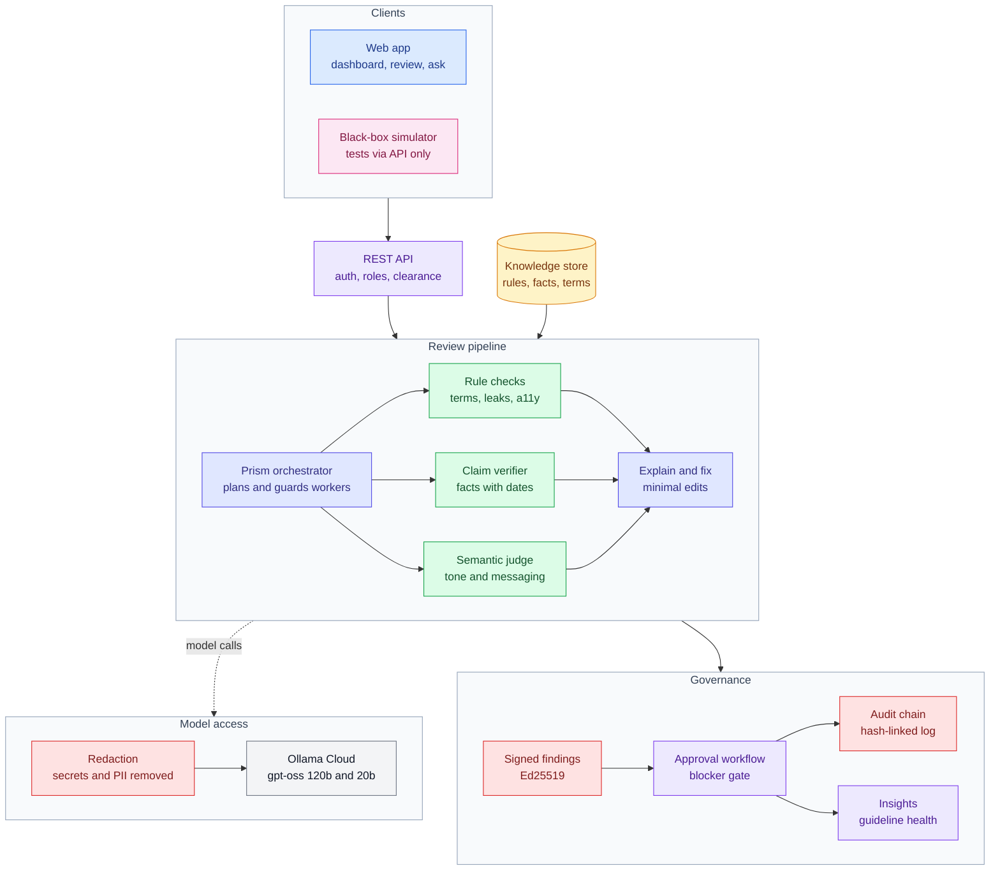

# Verytas

**Brand governance before you hit publish.** Verytas reviews content against a company's approved rules, time-valid facts and confidential terms. It explains every issue with a citation, proposes the smallest fix that keeps the writer's intent, and routes the piece through a human approval workflow. It also learns which guidelines are unclear from how reviewers override them.

Built for the Inkloom AI brand-governance challenge. Brief: [`docs/problem-statement.md`](docs/problem-statement.md) · design: [`docs/architecture.md`](docs/architecture.md)

## What it does

- **Checks every draft** for banned and preferred wording, brand casing, leaked codenames, outdated or inflated statistics, unsupported superlatives, tone, and accessibility (alt text, contrast, hashtags, link text, readability).
- **Verifies claims against approved facts** with validity windows, so last year's number is flagged as outdated rather than passed.
- **Explains and fixes.** Each finding cites the rule or fact it rests on. Fixes are minimal edits, kept only if an intent check says the message and call to action survived.
- **Keeps humans in charge.** A draft, review, approve, publish workflow, where blockers (including checks that could not run) need an explicit, noted override.
- **Shows where the brand book is weak.** Guideline health ranks rules by override rate, reviewer disagreement and "unclear" feedback.

## Architecture



**Legend:** blue = clients · purple = API and workflow · indigo = orchestration · green = checks · red = security · amber = data · grey = external models · pink = test harness

### How a review flows

1. A creator submits a draft. The API checks their role and clearance, stores a new version and queues a review.
2. **Prism** loads only the rules and facts the content's tier may see, then fans out to three stateless workers under timeouts and circuit breakers.
3. **Rule checks** are deterministic and Unicode-aware. The **claim verifier** extracts claims and compares every figure with the approved fact for that date. The **semantic judge** answers per-rule yes/no and tone-level questions with probabilities.
4. Confidential terms and personal data are **redacted** before any text reaches a model.
5. Model-judged findings get a plain explanation and a minimal fix, which is dropped unless the meaning survives. Every finding is **signed**, so a level or fix edited in the database fails verification.
6. Reviewers accept, reject or edit each finding. Approval is gated on blockers and on checks that didn't run, and every action lands in the **hash-chained audit log**.

## Tested from the outside

[`blackbox/`](blackbox/README.md) is a reality simulator that knows Verytas only through its API. It invents brand worlds, writes roasts, flame wars, Hinglish captions and crisis apologies inside them, and plants violations with exact ground truth, including evasive spellings. A bandit then steers each generation toward what Verytas misses. Its first runs found that public posts skipped the built-in checks, that look-alike letters slipped past banned-term and leak checks, and that parallel submissions hit database deadlocks and 500s.

On a 216-case campaign, core recall rose from 78% to 96%, false positives on controls fell from 7% to 0%, and server errors went from 17 to 0, even at 32 parallel submissions.

## Repository layout

| Path | What |
| --- | --- |
| `backend/` | FastAPI service: checks, Prism, workflow, insights, security (Python 3.12+) |
| `web/` | Next.js 16 on OpenUI: dashboard, review workspace, guideline health, Ask Verytas |
| `blackbox/` | Black-box reality simulator and its reports |
| `docs/` | Problem statement, architecture, submission checklist |

## Run locally

```bash
# Backend on :8000 (tests run fully offline, no keys needed)
cd backend
python3 -m venv .venv && .venv/bin/pip install -e ".[dev]"
cp .env.example .env              # add OLLAMA_API_KEY for live models
.venv/bin/uvicorn verytas.main:app --reload
.venv/bin/pytest -q

# Frontend on :3000
cd web
pnpm install
cp .env.example .env.local        # VERYTAS_API_URL + VERYTAS_API_TOKEN for live data, OLLAMA_API_KEY for Ask
pnpm dev
```

On first run, `POST /bootstrap` creates the workspace and returns an admin token (interactive docs at `/docs`). Without backend settings, the frontend shows clearly labelled demo data.

## Models and external services

| Service | Used for | When |
| --- | --- | --- |
| Ollama Cloud (`gpt-oss:120b`, `gpt-oss:20b`) | claim extraction, explanations, fixes, the semantic judge, Ask Verytas, simulator content | when `OLLAMA_API_KEY` is set |
| TypeSafe Jev (`jev-1.13.0`) | semantic judge, if preferred | optional, when `TYPESAFE_API_KEY` is set |
| Anthropic Claude | alternative LLM backend | only with `VERYTAS_LLM_BACKEND=claude` |
| Sentry | error monitoring, without request bodies or PII | only when `SENTRY_DSN` is set |

With no keys, semantic checks fall back to an offline heuristic, and the scorecard marks them "degraded" rather than passed.

## Working agreement

- `main` is production; merging into it deploys. `dev` is the integration branch; open PRs into `dev`.
- Commit small and often from your own account, since judges may read the history.
- Disclose templates, boilerplate, external services and significant AI assistance, per the challenge rules.
