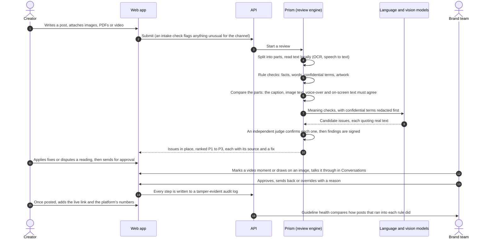
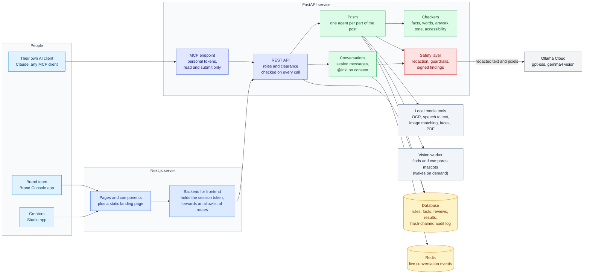
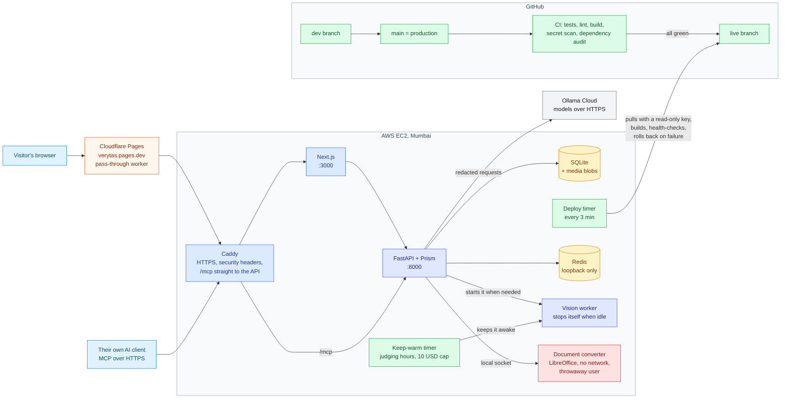

<div align="center">

<picture>
  <source media="(prefers-color-scheme: dark)" srcset="docs/assets/logo-dark.svg">
  
</picture>

# Verytas

**Brand review that shows its work.**

Verytas checks every post, caption, image, document and video against a brand's own rules and approved facts *before* it is published, explains each problem with a citation, suggests the smallest fix, and leaves the final call to a person.

[**Try the live demo**](https://verytas.pages.dev) · [Architecture](docs/architecture.md) · [Problem statement](docs/problem-statement.md)


</div>

<p align="center"></p>

## The problem

A brand works with dozens of creators and agencies who post every day, in many languages and formats. One wrong number, a leaked product codename or a snide line about a competitor can cost real money and trust. Checking all of it by hand doesn't scale, and generic AI checkers flag things without saying *why*, so people stop trusting them.

## What Verytas does

| Capability | What it means |
| --- | --- |
| **Reads everything in a post** | The caption, text inside images (OCR), every page of a PDF or Word file (including text drawn as shapes), every slide of a PowerPoint deck (speaker notes and hidden slides too), every sheet of an Excel workbook, an HTML page or email (title, share text, alt text; nothing linked is fetched), and video: on-screen text, subtitles and speech. |
| **Sees what is in the pictures** | Finds the brand's official artwork and says how it was misused: stretched, squashed, skewed, mirrored, recoloured or redrawn, with the box. Finds the brand's mascots even when an AI has redrawn them and names what changed (a wrong colour, an extra eye, a missing tail), with the box and, in video, the time range. Identifies faces against the brand's approved people and flags anyone shown without an agreement. |
| **Hears what is said** | Speech in English, Hindi and Hinglish is transcribed on the server. A codename said aloud is caught by how it sounds, and a price or percentage spoken in Hindi ("chalis pratishat") is read as the figure, so it is checked against the caption and the approved facts like any written one. |
| **Checks it against the brand's own sources** | Approved facts with validity dates, banned and preferred words, confidential terms, official artwork, tone, accessibility and AI-disclosure rules. |
| **Explains every flag** | Each issue quotes the exact passage and cites the rule or fact behind it, with page numbers. No unexplained scores. |
| **Shows where, in every file** | Issues are marked in place: in the caption, boxed on the image, and inside attached documents page by page (slide by slide, sheet by sheet). *Preview* shows a document as it looks, with a box on each flagged phrase; a sheet becomes a table with the flagged cells tinted. |
| **Fixes, not just flags** | It swaps a phrase, rewrites a sentence or removes a dig, whichever the rule needs, and a judge that knows the rule checks the offer and call to action survive. One click applies it. |
| **Keeps people in charge** | Creators can dispute a reading; the brand team walks through the issues one by one (asking for a fix, keeping it as is with a reason, or escalating), then approves or sends the piece back with the fixes it asked for, and every override needs a written reason. |
| **Easy to pick up** | A guided tour on the first visit to each side, plain-word summaries of any piece, and every status, score and empty page explained where it appears. Shaped by [user testing](docs/research/user-testing.md) with three first-time users. |
| **Talks it through** | *Conversations* between a creator and the brand team, next to the piece in question: replies, edits, deletes, files with previews, and meeting links that become a Join card. Encrypted at rest, live over Redis (it falls back to one process without it). Mention **@Inki** and the assistant answers from the record, only after the person asking has agreed that it may read the conversation. |
| **Marks the exact spot** | Videos play in the review with each issue on the timeline; drag along it to comment on a stretch, at 0.5x to 2x, with no download. Images take a marker, an eraser and text, saved with the comment, so the creator sees what to change in place. |
| **Learns how posts did** | Once a piece is live, its link and the platform's numbers go on the piece (typed, or a sheet for the brand team). Guideline health then shows, per rule, how posts that ran into it did against those that didn't, as a range, and only once there are enough posts. Nothing is read from the platforms. |
| **Works from your AI client** | A personal token lets Claude Desktop, Claude Code or any MCP client read your reviews, search and submit text as you, never more: no approving, no confidential terms ([how](docs/mcp.md)). |
| **Learns from decisions** | Rules that reviewers keep overriding are surfaced as unclear, and model-judged rules tune how confident they must be before flagging. |

## Try it in 60 seconds

<p align="center"></p>

1. Open **[verytas.pages.dev](https://verytas.pages.dev)** and pick a person at *Kitepath*, a made-up online learning brand with eight weeks of history. A short tour shows where things are; skip it, or replay it from Settings.
2. As **Dev Sharma** (creator), open *My reviews*, paste a caption like *"Kitepath has 2 million learners. Guaranteed results!"* and run it. The claim is checked against the approved fact (1.2 million), a fix appears, and the promise is flagged. Apply the fixes and send it for approval.
3. Use **Switch account** to become **Arjun Mehta** (brand team). Your piece is now in the review queue, ranked by what needs attention first. Approve it, or send it back with a note.

<p align="center"></p>

<p align="center"></p>

## How a review works



## Architecture



- **Two apps, one codebase.** Creators get *Studio*; the brand team gets the *Brand Console*. The API enforces the split on every call, so a creator can never open another creator's work.
- **The browser never holds an API key.** The Next.js server keeps the session token and forwards only an allowlisted set of routes.
- **Prism** splits a submission into its parts and spawns an agent for each one: a PDF gets an agent per page (a deck per slide, a workbook per sheet), every image inside it gets its own OCR and artwork agents, and every piece of text found goes through the same checks as typed text. Depth and agent counts are capped, and anything cut off is reported as *not checked* rather than silently passed.
- **Rules before models.** Facts, words, confidential terms and artwork are checked deterministically. Models only handle meaning (tone, implied claims, sarcasm), and a model-only finding can never block a post on its own.

## System design



| Decision | Why |
| --- | --- |
| **Pull-based deploys** | The server pulls a branch that only CI can move, with a read-only key. No inbound SSH from CI, and a commit that fails any check never ships. Each release builds beside the live one and rolls back automatically if it fails its health checks. |
| **Heavy media work stays local** | OCR, speech to text, PDF rendering and artwork matching run on the server's CPU, so raw images and audio never leave the machine. Only redacted text and pixels go to a model. |
| **Bounded concurrency everywhere** | A shared pool of model slots, a cap on reviews running at once, and per-step deadlines. A burst of uploads queues instead of exhausting memory or hammering a provider. |
| **Circuit breakers on every model** | If a provider is down, its checks are marked *degraded* on the review instead of failing the whole thing or pretending they passed. |
| **Vision on a worker that sleeps** | Finding redrawn mascots needs three image models and torch, too heavy for the always-on server. They run on a second instance that the API starts on the first review needing it and that stops itself after 20 idle minutes, so it costs nothing most of the time. It installs from GitHub alone and holds no brand data. |
| **Untrusted files in a sealed room** | Word and PowerPoint previews need LibreOffice, a large program reading files strangers upload. It runs in its own socket-started service, one file at a time, as a user created for that run, with no network and no view of the app's files or secrets, under memory, CPU and time limits; the file has every reference to anything outside it cut before it gets there. |
| **One cheap server** | One small ARM instance behind a free edge, with an AWS budget that stops it at a hard cap. The demo runs on credits, at no cost to the team. |

## Tech stack

| Layer | Tools |
| --- | --- |
| **Frontend** | Next.js 16 (App Router, React 19), Tailwind CSS 4, OpenUI for generated answers in *Ask Inki* |
| **Backend** | Python 3.12, FastAPI, SQLAlchemy 2 (async), SQLite (Postgres-ready), Pydantic |
| **AI models** | Ollama Cloud: `gpt-oss:120b` and `gpt-oss:20b` for language, `gemma4:31b` for vision. Swappable for TypeSafe Jev or Anthropic Claude |
| **Media, all local** | RapidOCR (ONNX Runtime), faster-whisper, OpenCV (with YuNet and SFace for faces), pdfium, PyAV, LibreOffice (sandboxed, for Word and PowerPoint previews) |
| **Vision worker** | Grounding DINO (tiny), SAM 2.1 (tiny), DINOv2 (small) on PyTorch CPU, on an EC2 Graviton instance that wakes on demand |
| **Security** | Ed25519-signed findings, SHA-256 hash-chained audit log, text and pixel redaction, input guardrails, CSP |
| **Infra and delivery** | AWS EC2, Caddy, systemd, Cloudflare Pages, GitHub Actions (pinned to commit SHAs), gitleaks, pip-audit, pnpm audit |
| **Testing** | pytest (offline, no keys needed), a black-box simulator that tests only through the public API |

## Accessibility

**In what it reviews.** Built-in rules, on for every brand: images without alt text, text below WCAG
contrast, hashtags not written in CamelCase (screen readers read them as one word), long runs in capitals,
links described only as "click here", paragraphs too long to read easily, video speech without captions,
and runs of emoji (each is read aloud by name). Missing alt text and low contrast must be fixed before
approval; the rest are suggestions.

**In the app itself.** Every control is reachable by keyboard with a visible focus ring, a skip link leads to
the content, icon buttons carry labels, toasts and progress are announced through live regions, animation is
turned off for anyone who asks their system for less motion, both apps have a light and a dark theme, and the
page language is declared. It has not been audited against WCAG by an outside tester.

## Trust and security

- **Every finding is signed** when it is made, so an edited verdict shows as tampered.
- **Every action is logged** in a hash-chained audit log; changing or deleting an old entry breaks the chain, and anyone with audit access can verify it.
- **Confidential terms never reach a model**: they are redacted from text and blacked out in image pixels first, including a codename said without its "Project". Confidential-tier content is never sent as pixels at all.
- **The assistants keep their instructions to themselves.** Asking a chat for its prompt gets a fixed answer, and a reply that starts reciting it is cut off before any of it is sent ([how](docs/security/README.md#the-chat-assistants-instructions)).
- **People's faces follow the brand's records.** A face is identified against the approved-people library; public portraits are looked up only when the brief names someone and the content isn't confidential.
- **Uploaded files are handled as hostile.** Types are read from the bytes; zips, XML and pictures are read within size and pixel budgets; a web page is shown only in a frame with no scripts and a policy that loads nothing from outside, after every outside address is cut from it; Word and PowerPoint are converted in a sealed service (above).
- **Checked before going public.** The whole git history was scanned for secrets with gitleaks: none.
- **Signing out ends the session at the server.** A password account's token is revoked on sign-out and lapses after 7 days.
- **What people type is screened too.** Bribes and instructions aimed at the AI are refused before they are stored. Contact details are flagged for the brand team, never refused: a long number is as often an order code.
- **Access follows role and clearance**, checked on the server on every request, including in the audit log.
- **Your own AI client can use it, as you and no more.** A personal token lets Claude Desktop, Claude Code or any MCP client read your content and reviews and submit text, with your permissions, a clearance ceiling, a rate limit and an audit entry per call; it can never decide, approve or publish ([how](docs/mcp.md)).
- **Audited.** A security review with the Cloudflare security-audit method ran on this codebase; its confirmed findings and the leads it raised are fixed, each with a regression test. The [security report](docs/security/README.md) lists every item, the commit that fixed it, and what is still open.
- **Locked dependencies.** The backend and the vision worker install from hashed lock files, and model files are pinned by SHA-256, so production runs exactly what the tests ran.
- **The live site is reviewed too.** Role checks, cross-site refusals, the browser-only route allowlist, cookie flags and the shipped bundles were checked against the deployed demo; what it found is fixed and listed in the security report.

## Round 3: what changed

The three improvements committed to after Round 2, and where each stands.

| Improvement | Built | Not built, and why |
|---|---|---|
| **Creators and managers talk it through** | *Conversations* beside the piece in question: replies, edits, files with previews, unread counts, and Meet, Teams or Zoom links that become a Join card. Each exchange is kept with its time, beside the piece, so the meeting's record is the conversation itself. | Voice through masked temporary phone numbers. Telephony is a separate, paid infrastructure; for a prototype it would cost money every month and add little over the free meeting apps people already use. |
| **Sharper vision and speech** | Recoloured app icons found by outline: 33% to 100%. Mascots: a part the cut-out clipped no longer reads as missing, and a stretched body is named (false alarms 64 to 50 of 180, stretched 0 to 18 of 30). The vision worker wakes on demand and is kept warm in judging hours inside a 10 USD cap. Before and after are published for each ([artwork](backend/evals/results/assets.md), [mascots](backend/evals/results/mascots.md)). | A GPU, and with it a stronger Hindi speech model: AWS refused the GPU quota twice, so the models run on CPU. Hindi is helped instead by matching codenames by sound. |
| **The Brand Console runs it** | An approved-people tab with agreement dates; videos with each finding as a mark on the timeline, range comments and 0.5x to 2x; images marked up with a marker, eraser and text, which the creator sees in place. | |

<p align="center"></p>

Also added in Round 3: performance feedback (a live post's link and numbers on the piece, compared per rule in
Guideline health), a personal-token MCP endpoint, a landing page, and Redis behind conversations.

**Reliability.** A test sends every API route the inputs nobody should send (ids that overflow, wrong types,
empty and oversized bodies) as each role, and fails on any server error; it found and fixed a class of 500s.
The live site is crawled as every demo person, every page loaded and refreshed, with console and server
errors recorded. Every batch of changes is reviewed for bugs before it is committed, and each finding is
fixed or answered with a reason in the project ledger.

## Quality

Each engine is measured on its own benchmark through the production code. The sets are generated or
hand-labelled rather than live traffic, so real-world figures will run somewhat lower. Each link has the
method and the full results.

| Engine | Tested on | Result |
| --- | --- | --- |
| [Artwork](backend/evals/results/assets.md) | 1,200 scenes | **96%** of misuse caught, **4.7%** false alarms; recoloured app icons **24/24** (33% before), found by outline when the colours are swapped |
| [Mascots](backend/evals/mascots) | 425 scenes | every character found; most defects named (extra eyes 25/28, recolours 30/30), a stretched body 18/30 (was 0); false alarms on acceptable characters 50/180 (was 64) ([details](backend/evals/results/mascots.md)) |
| [Text in images](backend/evals/results/ocr.md) | 240 images | **88%** of prices, codes and names read exactly |
| [Speech](backend/evals/results/speech.md) | 104 clips | about **10%** word error in English; Hindi much weaker, so codenames are also matched by sound |
| [Video](backend/evals/results/video.md) | 36 videos | on-screen claims **11/11**, spoken claims **8/10**, artwork misuse 32/45, each at the right moment |
| [Parts that disagree](backend/evals/results/crossmodal.md) | 28 posts | **14/14** caught, **0** false alarms |
| [Judgement rules](backend/evals/results/second_look.md) | 32 sentences | **30/32** right |
| [Suggested fixes](backend/evals/results/summary.md) | 73 findings | **82%** useful (45% before), **0** invented numbers |
| [Black-box simulator](blackbox/README.md) | 216 cases | **96%** recall, **0%** false alarms on clean posts |

- **Over 700 backend tests** run offline on every push, including a sweep that sends every API route input nobody should send and fails on any server error, with type checks, lint and a production build for the web apps.
- **Tried by people.** Three first-time users outside the team used the live demo and wrote up what confused them. Each point has a shipped change, listed in the [user testing report](docs/research/user-testing.md).
- **Tested from the outside.** [`blackbox/`](blackbox/README.md) knows Verytas only through its API: it invents brands and posts with planted violations and steers each round toward what Verytas misses.

## Known limits

- **Measured on generated sets.** Every benchmark above is generated or hand-labelled, not live traffic, and
  some thresholds were set on the same sets, so real figures will be lower.
- **Mascots on busy backgrounds** still raise false alarms (50 of 180 acceptable scenes); most come from the
  cut-out, not the comparison.
- **Hindi speech** is transcribed with much error on CPU; codenames are caught by sound, other Hindi claims
  less reliably.
- **Post numbers are typed or imported**, not read from the platforms.
- **No voice calls inside Verytas**; meetings run on the apps people already use.
- **Open security items** (a script nonce, token rotation, per-user limits on Ask Inki) are listed in the
  [security report](docs/security/README.md#hardening-notes).

## What comes next

- **Sharper visual checks on busy backgrounds**, where a mascot's cut-out still clips or takes in background: a better segmenter for thin appendages would close most of the gap to the true mask (50 against 21 false alarms in 180).
- **Performance from the platforms themselves:** Instagram's insights first, pulled for posts whose link is recorded, so the numbers no longer need typing.
- **A GPU** for the language, vision and Hindi speech models once AWS grants the quota; the general speech model still mishears much Hindi.

## Run it locally

```bash
# Backend on :8000 (tests need no keys)
cd backend
python3 -m venv .venv && .venv/bin/pip install -e ".[dev]"
cp .env.example .env                 # add OLLAMA_API_KEY for live models; VERYTAS_REDIS_URL is optional
.venv/bin/pytest -q
.venv/bin/python -m verytas.cli seed-showcase --db showcase.db --write-env ../web/.env.local
VERYTAS_DATABASE_URL=sqlite+aiosqlite:///./showcase.db .venv/bin/uvicorn verytas.main:app

# Web apps, each in its own terminal
cd web
pnpm install
pnpm dev:manager                     # Brand Console on :3000
pnpm dev:creator                     # Studio on :3001
```

The seed creates the *Kitepath* brand with seven creators and eight weeks of history, and writes their tokens into `web/.env.local`. Without any API keys, model-judged checks fall back to an offline heuristic and every review says so. Without a backend, the web app shows clearly labelled sample data.

## Repository layout

| Path | What is inside |
| --- | --- |
| [`backend/`](backend) | FastAPI service: checkers, Prism, workflow, insights, security |
| [`web/`](web) | Next.js: the Studio and Brand Console apps |
| [`blackbox/`](blackbox) | The black-box simulator |
| [`deploy/`](deploy) | Server setup, pull-based deploys, the edge worker ([how it works](deploy/README.md)) |
| [`docs/`](docs) | Problem statement and the full architecture |

## Working agreement

- `main` is production, and merging into it deploys. `dev` is the integration branch.
- Templates, external services and significant AI assistance are disclosed, per the challenge rules.
