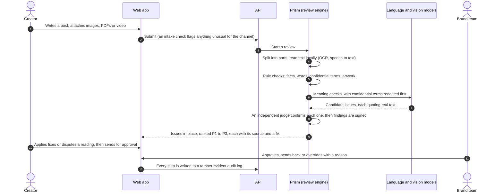
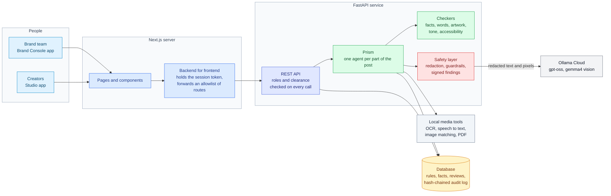
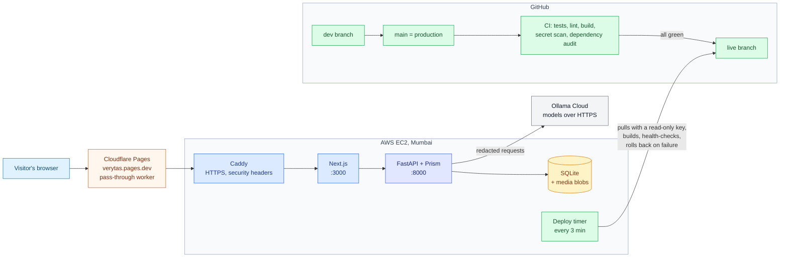

<div align="center">

<picture>
  <source media="(prefers-color-scheme: dark)" srcset="docs/assets/logo-dark.svg">
  
</picture>

# Verytas

**Brand review that shows its work.**

Verytas checks every post, caption, image, document and video against a brand's own rules and approved facts *before* it is published, explains each problem with a citation, suggests the smallest fix, and leaves the final call to a person.

[**Try the live demo**](https://verytas.pages.dev) · [Architecture](docs/architecture.md) · [Problem statement](docs/problem-statement.md)


</div>

<p align="center"></p>

## The problem

A brand works with dozens of creators and agencies who post every day, in many languages and formats. One wrong number, a leaked product codename or a snide line about a competitor can cost real money and trust. Checking all of it by hand doesn't scale, and generic AI checkers flag things without saying *why*, so people stop trusting them.

## What Verytas does

| Capability | What it means |
| --- | --- |
| **Reads everything in a post** | The caption, text inside images (OCR), every page of a PDF or Word file, and video: on-screen text, subtitles and speech. |
| **Checks it against the brand's own sources** | Approved facts with validity dates, banned and preferred words, confidential terms, official artwork, tone, accessibility and AI-disclosure rules. |
| **Explains every flag** | Each issue quotes the exact passage and cites the rule or fact behind it, with page numbers. No unexplained scores. |
| **Fixes, not just flags** | It proposes the smallest change that keeps the writer's meaning. One click applies it. |
| **Keeps people in charge** | Creators can dispute a reading; the brand team approves, sends back or overrides, and every override needs a written reason. |
| **Learns from decisions** | Rules that reviewers keep overriding are surfaced as unclear, and model-judged rules tune how confident they must be before flagging. |

## Try it in 60 seconds

1. Open **[verytas.pages.dev](https://verytas.pages.dev)** and pick a person at *Kitepath*, a made-up online learning brand with three weeks of history.
2. As **Dev Sharma** (creator), open *My reviews*, paste a caption like *"Kitepath has 2 million learners. Guaranteed results!"* and run it. The claim is checked against the approved fact (1.2 million), a fix appears, and the promise is flagged. Apply the fixes and send it for approval.
3. Use **Switch account** to become **Arjun Mehta** (brand team). Your piece is now in the review queue, ranked by what needs attention first. Approve it, or send it back with a note.

<p align="center"></p>

## How a review works



## Architecture



- **Two apps, one codebase.** Creators get *Studio*; the brand team gets the *Brand Console*. The API enforces the split on every call, so a creator can never open another creator's work.
- **The browser never holds an API key.** The Next.js server keeps the session token and forwards only an allowlisted set of routes.
- **Prism** splits a submission into its parts and spawns an agent for each one: a PDF gets an agent per page, every image inside it gets its own OCR and artwork agents, and every piece of text found goes through the same checks as typed text. Depth and agent counts are capped, and anything cut off is reported as *not checked* rather than silently passed.
- **Rules before models.** Facts, words, confidential terms and artwork are checked deterministically. Models only handle meaning (tone, implied claims, sarcasm), and a model-only finding can never block a post on its own.

## System design



| Decision | Why |
| --- | --- |
| **Pull-based deploys** | The server pulls a branch that only CI can move, with a read-only key. No inbound SSH from CI, and a commit that fails any check never ships. Each release builds beside the live one and rolls back automatically if it fails its health checks. |
| **Heavy media work stays local** | OCR, speech to text, PDF rendering and artwork matching run on the server's CPU, so raw images and audio never leave the machine. Only redacted text and pixels go to a model. |
| **Bounded concurrency everywhere** | A shared pool of model slots, a cap on reviews running at once, and per-step deadlines. A burst of uploads queues instead of exhausting memory or hammering a provider. |
| **Circuit breakers on every model** | If a provider is down, its checks are marked *degraded* on the review instead of failing the whole thing or pretending they passed. |
| **One cheap server** | One small ARM instance behind a free edge, with an AWS budget that stops it at a hard cap. The demo runs on credits, at no cost to the team. |

## Tech stack

| Layer | Tools |
| --- | --- |
| **Frontend** | Next.js 16 (App Router, React 19), Tailwind CSS 4, OpenUI for generated answers in *Ask Verytas* |
| **Backend** | Python 3.12, FastAPI, SQLAlchemy 2 (async), SQLite (Postgres-ready), Pydantic |
| **AI models** | Ollama Cloud: `gpt-oss:120b` and `gpt-oss:20b` for language, `gemma4:31b` for vision. Swappable for TypeSafe Jev or Anthropic Claude |
| **Media, all local** | RapidOCR (ONNX Runtime), faster-whisper, OpenCV, pdfium, PyAV |
| **Security** | Ed25519-signed findings, SHA-256 hash-chained audit log, text and pixel redaction, input guardrails, CSP |
| **Infra and delivery** | AWS EC2, Caddy, systemd, Cloudflare Pages, GitHub Actions (pinned to commit SHAs), gitleaks, pip-audit, pnpm audit |
| **Testing** | pytest (offline, no keys needed), a black-box simulator that tests only through the public API |

## Trust and security

- **Every finding is signed** when it is made, so an edited verdict shows as tampered.
- **Every action is logged** in a hash-chained audit log; changing or deleting an old entry breaks the chain, and anyone with audit access can verify it.
- **Confidential terms never reach a model**: they are redacted from text and blacked out in image pixels first. Confidential-tier content is never sent as pixels at all.
- **What people type is screened too.** Bribes, "WhatsApp me" style contact swaps and instructions aimed at the AI are refused before they are stored.
- **Access follows role and clearance**, checked on the server on every request, including in the audit log.
- **Audited.** A security review with the Cloudflare security-audit method ran on this codebase; its confirmed findings are fixed, each with a regression test.

## Quality

- **Over 320 backend tests** run fully offline in about 25 seconds, plus type checks, lint and a production build for the web apps, all on every push.
- **Tested from the outside.** [`blackbox/`](blackbox/README.md) is a simulator that knows Verytas only through its API. It invents brands, writes posts, images, PDFs and video with planted violations, and steers each round toward what Verytas misses. Across a 216-case campaign, recall on core checks rose **from 78% to 96%**, false alarms on clean posts fell **from 7% to 0%**, and server errors fell **from 17 to 0**, even at 32 parallel submissions.

## What comes next

- **One-on-one meetings.** A creator asks the manager who looks after them for a meeting by chat, voice or video; the manager accepts or proposes another time or way. Calls go through temporary masked numbers, the way delivery apps connect a rider and a customer, and only the time, the way and an outcome note go on the record. It is designed and previewed in both apps (marked *Planned*), not built: in a demo one person plays both sides, and masked calling needs a paid telephony provider.
- **Self-hosted vision and video models** on a GPU that wakes on demand, so confidential artwork never leaves the brand's own cloud.
- **Finer image and video decomposition:** layout regions, logo placement and scene-by-scene checks in place of whole-frame reads.

## Run it locally

```bash
# Backend on :8000 (tests need no keys)
cd backend
python3 -m venv .venv && .venv/bin/pip install -e ".[dev]"
cp .env.example .env                 # add OLLAMA_API_KEY for live models
.venv/bin/pytest -q
.venv/bin/python -m verytas.cli seed-showcase --db showcase.db --write-env ../web/.env.local
VERYTAS_DATABASE_URL=sqlite+aiosqlite:///./showcase.db .venv/bin/uvicorn verytas.main:app

# Web apps, each in its own terminal
cd web
pnpm install
pnpm dev:manager                     # Brand Console on :3000
pnpm dev:creator                     # Studio on :3001
```

The seed creates the *Kitepath* brand with seven creators and three weeks of history, and writes their tokens into `web/.env.local`. Without any API keys, model-judged checks fall back to an offline heuristic and every review says so. Without a backend, the web app shows clearly labelled sample data.

## Repository layout

| Path | What is inside |
| --- | --- |
| [`backend/`](backend) | FastAPI service: checkers, Prism, workflow, insights, security |
| [`web/`](web) | Next.js: the Studio and Brand Console apps |
| [`blackbox/`](blackbox) | The black-box simulator |
| [`deploy/`](deploy) | Server setup, pull-based deploys, the edge worker ([how it works](deploy/README.md)) |
| [`docs/`](docs) | Problem statement and the full architecture |

## Working agreement

- `main` is production, and merging into it deploys. `dev` is the integration branch.
- Templates, external services and significant AI assistance are disclosed, per the challenge rules.
