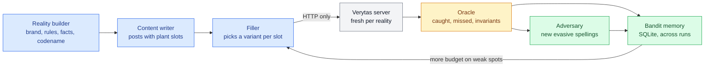

# Black-box reality simulator

A test agent that knows Verytas only from the outside: its HTTP API and the docs a customer would get. It invents brand worlds, writes the kind of content people actually post in them, plants violations with exact ground truth, and grades every review it gets back. It never imports the backend, so a bug shared by the product and its tests can't hide.

## How it works



1. **Reality.** A fictional brand with a voice, banned phrases, a confidential codename and statistics whose approved value changed on a known date. Six hand-written worlds ship for offline runs; with an Ollama key, `gpt-oss:120b` invents new ones.
2. **Templates.** Roasts, flame wars, Hinglish captions, crisis apologies, sponsored posts, release notes and 20 more genres, with `{{S1}}`-style slots where a plant goes. One LLM call yields a template that is filled many times, so a few calls become hundreds of cases.
3. **Plants.** Each slot is filled by an *arm*, a (family, variant) pair: a banned term written with a Cyrillic look-alike, a codename hidden by a zero-width space, last year's statistic in Indian digit grouping, alt text that is a file name. Controls (a true statistic, a camel-case hashtag) measure false positives.
4. **Grading.** A plant counts as caught when a finding in an acceptable category overlaps its span. Contract invariants are checked on every review: spans match their quotes, findings cite a source, signatures verify, fixes edit text that exists, nothing returns a 5xx, the approval gate refuses content with blockers, and the audit chain verifies.
5. **Learning.** Thompson sampling over each arm's failure rate puts most of the next generation on what failed, and the stats persist across runs. In LLM mode an adversary invents new spellings for terms that slipped through, and those become arms too.

Expectations come from what a careful reviewer holding the brand book would say, never from how Verytas is built.

## Run it

From the repo root, using the backend's virtualenv:

```bash
backend/.venv/bin/python -m blackbox run                       # offline: no keys, ~200 cases in about 10 seconds
backend/.venv/bin/python -m blackbox run --gen llm             # LLM-written worlds and posts (Ollama Cloud)
backend/.venv/bin/python -m blackbox run --gen llm --review live --templates 5 --fills 2   # full live loop
backend/.venv/bin/python -m blackbox report                    # last run's report
backend/.venv/bin/python -m blackbox arms                      # what the bandit has learned
```

Useful flags: `--realities`, `--templates`, `--fills`, `--generations`, `--concurrency`, `--seed`. Live reviews cost several model calls per case, so keep them small on the free plan.

Runs, reports and server logs go to `blackbox/.runs/` (gitignored).

## What it has found so far

| Finding | Fix |
| --- | --- |
| Built-in rules were seeded "internal", so public posts skipped every leak, claim and accessibility check | seeded as public |
| Banned terms and codenames slipped through with look-alike letters, zero-width spaces, full-width text or non-breaking hyphens, including on egress redaction | Unicode folding with an offset map back to the original text |
| "1,40,000" (Indian grouping) parsed as two numbers, flagging a true statistic | grouping-aware number parser |
| "#1" superlatives were never matched | lookarounds instead of `\b` |
| Alt text set to a file name passed | flagged |
| 500s under parallel load: SQLite lock upgrades, a review holding a transaction across model calls, and the audit lock taken in the opposite order to the database lock | `BEGIN IMMEDIATE`, no transaction across provider calls, and one lock for audit appends on SQLite |

On the same offline campaign (216 cases): core recall went from 78% to 96%, false positives on controls from 7% to 0%, and server errors at 12 parallel submissions from 17 to 0. The campaign itself went from 164 s to 10 s once the lock stalls were gone, and 320 cases at 32 parallel submissions run clean.

## Known gaps it still reports

- Letter-spaced (`f a s t e s t`) and leetspeak spellings of banned terms.
- In live mode, figures whose wording differs from the approved fact's subject are sometimes not linked to that fact.
